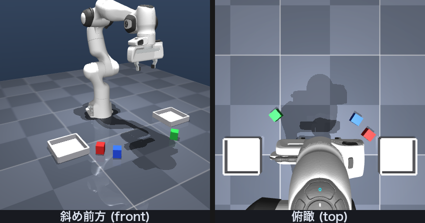
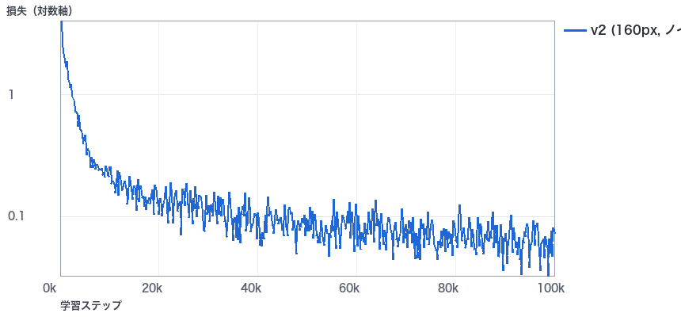
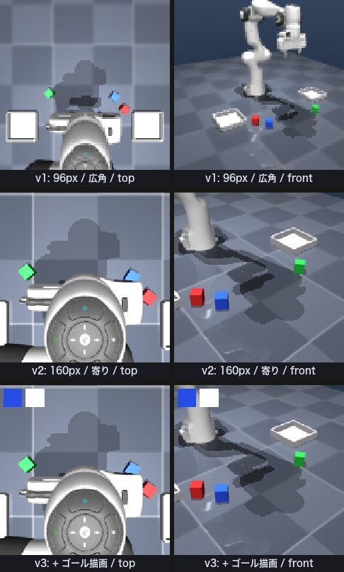

# 自然言語で指示する片付けロボット

ローカル LLM によるタスク分解と、模倣学習（ACT）による実行

Physical AI 講座 2026 応用編1 最終課題

---

## 1. 概要

机の上に置かれた 3 色のブロックを、日本語の指示どおりにトレイへ片付けるロボットを、MuJoCo 上に作りました。
「赤いブロックを手前のトレイに入れて」と書くと、手元で動かしているローカル LLM がそれを機械が扱える形に分解し、ロボットアームがそのとおりに動きます。

このシステムは 2 つの層でできています。

1. **解釈の層** — ローカル LLM（Ollama 上の qwen2.5-coder）が、自然言語の指示を `[{"color": "red", "tray": "B"}, ...]` という形のゴールの列に変換します。推論のみで、学習はしていません。
2. **実行の層** — ゴールと 2 台のカメラ画像から関節の指令を出します。ここは 2 通り実装しました。ひとつは手で書いた制御器（減衰最小二乗 IK + 状態機械）で、もうひとつはその制御器が集めた実演を模倣学習した ACT ポリシーです。

ブロックの位置はポリシーに数値では与えていません。毎回ランダムに置き直されるので、画像から読み取る必要があります。

実行環境はすべて手元の Mac（Apple Silicon）です。クラウドの GPU も外部 API も使っていません。

---

## 2. 目的

この課題で確かめたかったことは次の 3 つです。

- **自然言語をロボットの行動に落とすまでを、外部 API なしで一通り通せるか。** ローカル LLM は手元で完結し、通信も課金も発生しません。工場や家庭のように外に出せないデータを扱う現場を考えると、ここが成立するかどうかは実用上の分かれ目になります。
- **手で書いた制御器を、模倣学習で置き換えられるか。** 規範となる制御器を先に作り、そこから集めた実演でポリシーを学習する流れは、実機でのデータ収集にそのまま持っていける構成です。
- **うまくいかなかったときに、原因をどこまで切り分けられるか。** 実際、模倣学習の側は期待した性能に届きませんでした。そこで何が起きているのかを測って、仮説を立てて、潰していく過程を残すことを目的に切り替えました。本レポートの後半はその記録です。

---

## 3. システム構成

<div class="diagram">
<div class="row">
  <div class="box">自然言語の指示<br><span class="sub">「ブロックを全部手前のトレイに入れて」</span></div>
  <div class="arrow">→</div>
  <div class="box accent">ローカル LLM<br><span class="sub">qwen2.5-coder / Ollama<br>温度 0・JSON 出力・few-shot 5 例</span></div>
  <div class="arrow">→</div>
  <div class="box">ゴールの列<br><span class="sub">[{red,B},{blue,B},{green,B}]</span></div>
</div>
<div class="row down"><div class="arrow">↓</div></div>
<div class="row">
  <div class="box">MuJoCo<br><span class="sub">Franka Emika Panda<br>物理 500 Hz / 制御 50 Hz</span></div>
  <div class="arrow">←</div>
  <div class="box accent2">方策<br><span class="sub">(a) 減衰最小二乗 IK + 状態機械<br>(b) ACT（模倣学習）</span></div>
  <div class="arrow">←</div>
  <div class="box">観測<br><span class="sub">俯瞰 160×160 + 斜め前方 160×160<br>関節角 7 + グリッパ 1 + ゴール</span></div>
</div>
</div>

---

## 4. 実装

### 4.1 環境

`mujoco_menagerie` の Franka Emika Panda をそのまま読み込み、机・2 つのトレイ・3 個のブロック・カメラを足したシーンを作りました（`assets/franka_emika_panda/tidyup_scene.xml`）。



- ブロックは 44 × 44 × 50 mm、質量 50 g の自由関節つき剛体で、赤・青・緑が 1 個ずつ。
- トレイは手前（y = −0.38 m）と奥（y = +0.38 m）に固定。この視点では**手前が画面左、奥が画面右**に見えます。
- エピソードごとに、3 個のブロックの位置と向きをランダムに置き直します。
- 観測は俯瞰カメラと斜め前方カメラの 2 枚と、関節角 7 次元・グリッパ開度 1 次元・ゴール 5 次元（色 one-hot 3 + トレイ one-hot 2）。
- 行動は関節の目標角 7 次元 + グリッパ指令 1 次元の計 8 次元。
- 成功判定は「対象ブロックが対象トレイの中心から水平 7 cm 以内」「高さが 12 cm 未満」「静止していて手から離れている」の 3 つを同時に満たしたとき。

### 4.2 規範方策（手で書いた制御器）

位置 3 自由度と姿勢 3 自由度の減衰最小二乗 IK で手先を目標姿勢へ導き、「接近 → 降下 → 把持 → 持ち上げ → 搬送 → 設置 → 解放 → 退避」の 8 フェーズを順に進める状態機械です。各フェーズにタイムアウトを入れ、詰まったら次へ進みます。

ここで一度つまずきました。最初の実装では 6 回中 5 回、降下のフェーズで止まってしまいます。調べると、指令した関節角と実際の関節角がずれていて、手先の実位置が目標から **8.6 mm** 下にありました。Panda のアクチュエータは位置制御で、重力に対して定常偏差が残るためです。そこで IK の目標位置そのものに積分補正をかけ（ゲイン 0.2、補正量の上限 4 cm）、実測した手先位置が目標に追いつくようにしたところ、成功率が **300 本中 300 本（100%）** になりました。到達判定を指令値ではなく実測値で行っている点も、この問題に気づけた理由です。

### 4.3 データ収集

この規範方策で 300 エピソードを収集しました。

純粋な模倣学習は、学習時に見た状態から少しでも外れると誤差が積み上がって戻れなくなります（共変量シフト）。これを和らげるため、**実行する指令にだけガウスノイズ（σ = 0.015 rad）を加え、教師ラベルにはノイズを加えない前のきれいな指令を記録**しています。ずれた状態から正しい行動へ戻る例を、データに含めるためです。把持と解放のフェーズはノイズを入れると失敗するので除外しました。σ は 0.005 / 0.010 / 0.015 / 0.020 で掃引し、収集成功率が 95% を保てる上限として 0.015 を選びました。ノイズを入れた状態での収集成功率は **294 / 300（98.0%）** で、この 294 本・66,815 フレームを学習データにしました。

### 4.4 LLM プランナ

Ollama で動かした `qwen2.5-coder` に、JSON モード・温度 0・few-shot 5 例で問い合わせます。モデルの出力は表記がぶれるので、Python 側に対応表を置いて `赤 / あか / レッド / red / r` などを吸収し、ゴールの定義域（3 色 × 2 トレイ）に収まらないものは捨てます。JSON として読めなかったときは 1 回だけ「JSON だけ返して」と言い直します。

15 問のテストセット（`pai_final/planner_testset.py`）で **15/15（100%）**、推論は 1 問あたり平均 0.84 秒でした。

- 「ブロックを全部トレイBに入れて」→ 3 つのタスクに展開できる
- 「黄色いのを取って」→ 該当する色がないので、タスクを出さずに警告を返す
- 「手前／奥」は幾何的に一意に決まらないため、手前 = B・奥 = A という規約で解釈し、その旨を警告として添える

Ollama が起動していない場合は、黙って失敗せずに `PlannerConnectionError` を投げます。

### 4.5 ACT の学習

LeRobot 0.4.4 の ACT（Action Chunking Transformer）を使いました。ResNet18 を 2 本（カメラごと）と Transformer を組み合わせた 51.6M パラメータのモデルで、1 回の推論で 100 ステップ分の行動をまとめて出します。学習は Apple Silicon の GPU（MPS）で 100,000 ステップ、5.6 時間かかりました。



---

## 5. 結果

| 構成要素 | 指標 | 結果 |
| --- | --- | --- |
| LLM プランナ | テストセット 15 問の正解率 | **15 / 15（100%）** |
| LLM プランナ | 1 問あたりの推論時間 | 平均 0.84 秒（最小 0.42 / 最大 1.69） |
| 規範方策 | 300 本の成功率（ノイズなし） | **300 / 300（100%）** |
| 規範方策 | 300 本の成功率（σ=0.015 のノイズ注入時） | **294 / 300（98.0%）** |
| ACT（v2）| 未知配置 18 本の成功率 | **2 / 18（11.1%）** |
| ACT（v3）| 未知配置 18 本の成功率 | **1 / 18（5.6%）**（8 節） |

動画では、「ブロックを全部手前のトレイに入れて」の 1 文から 3 つのサブタスクが展開され、規範方策が 3 個を続けて片付けるところまでが通して動いています。

一方、模倣学習の側は 11.1% にとどまりました。原因を切り分けて改修した v3 でも上がらず、最良でも 11.1% です。以降はその原因を追った記録です。

---

## 6. うまくいかなかったこと、とその原因

### 6.1 v1：成功率 0%

最初の構成（96 px の広角カメラ 2 台、ノイズなしの実演 300 本・62,575 フレーム、100,000 ステップ）は、学習損失が 0.0517 まで下がっているのに、**18 本すべて失敗**しました。

損失が下がっているのに動かないとき、原因は大きく「そもそも学習データを覚えていない」か「覚えたが画像を見ていない」かに分かれます。これを切り分けるために、診断を 2 つ書きました（`scripts/diagnose_policy.py`）。

1. **学習データ上での行動誤差** — 学習に使った軌道をそのまま入れ、教師ラベルとの差を測る。結果は **0.0128 rad**。十分に小さく、「覚えていない」わけではないと分かります。
2. **画像を入れ替える反実仮想テスト** — 同じ関節状態のまま、別のエピソードの画像を与えて出力がどれだけ変わるかを測る。変化はわずか **0.0400 rad** で、行動そのものの標準偏差 **1.2289 rad** の 3% ほどしかありませんでした。

つまり、**画像がほとんど出力に効いていない**。関節角だけから「平均的な軌道」をなぞっているだけでした。原因として、観測画像の中でブロックが俯瞰 5.8 px・斜め前方 4.4 px しかなく、小さすぎることが考えられました。

対策として打ったのは 2 つです。

- カメラを寄せて画像を 160 px に上げる。ブロックは俯瞰で **5.8 → 16.8 px**、斜め前方で **4.4 → 13.2 px** になりました。
- 4.3 のノイズ注入を入れて実演を集め直す。



このとき副産物として、**把持の直前の区間では、俯瞰カメラから対象ブロックがほとんど見えていない**ことも分かりました。収集済みの 60 エピソードについて、グリッパを閉じ始める直前 20 フレームで対象色の画素が写っているかを数えたところ、俯瞰カメラでは **15.4%**（1200 フレーム中 185）しか見えていません。腕と手が真上からの視線を遮るためです。一方、斜め前方のカメラは **99.2%** を捉えており、少なくともどちらか一方から見えている割合も 99.2% でした（`scripts/measure_occlusion.py`）。2 台構成にしていたことが、把持の瞬間を救っていたことになります。

### 6.2 LeRobot の統計量計算に見つかったバグ

v1 の調査中に、LeRobot がデータセットの統計量を計算する箇所で、画像の標準偏差が **0 になる**ことに気づきました。uint8 のまま `mean(batch**2)` を計算しているため、二乗した時点でオーバーフローして値が壊れます。

手元で切り分けたところ、同じ画像に対して uint8 のまま計算すると std が `[0, 0, 0]`、float に直すと `[0.1313, ...]`、正しい値は `0.1644` でした。標準偏差が 0 だと正規化で画像が潰れるので、学習に直接効きます。

回避のため、`scripts/build_lerobot_dataset.py` に float64 でチャンネルごとの統計量を計算し直して `meta/stats.json` を書き換える処理を入れました。

### 6.3 v2：成功率 11.1%、しかし成功するのは赤だけ

カメラを寄せ、ノイズ注入した実演で学習し直した v2 は、**18 本中 2 本（11.1%）**まで上がりました。0% からは動きましたが、まだ低い。そして成功した 2 本はどちらも**赤いブロック**が対象でした。青と緑は 1 本も成功していません。

この偏りが手がかりになりました。全体の成功率だけでは、失敗が「狙いは正しいが掴めない」のか「そもそも別のブロックへ向かっている」のか分かりません。そこで、各エピソードで 3 個のブロックそれぞれについて、手先が最も近づいた距離と、エピソードを通した移動量を記録する診断を書きました（`scripts/diagnose_grasp_target.py`）。

| エピソード | 目標 | 結果 | 手先が最接近したブロック | 最も動いたブロック | 移動量 |
| --- | --- | --- | --- | --- | --- |
| 0 | 赤 → 奥 | 成功 | 赤 | 赤 | 0.266 m |
| 1 | 赤 → 手前 | 失敗 | **青** | **青** | 0.182 m |
| 2 | 青 → 奥 | 失敗 | **緑** | **緑** | 0.588 m |
| 3 | 青 → 手前 | 失敗 | **赤** | 赤 | 0.008 m |
| 4 | 緑 → 奥 | 失敗 | 緑 | 緑 | 0.015 m |
| 5 | 緑 → 手前 | 失敗 | **青** | **青** | 0.021 m |

**正しい色に最も近づけたのは 6 本中 2 本（33%）** で、これは 3 色からでたらめに選んだ場合とまったく同じ確率です。

ここで分かったことははっきりしています。**掴んで運ぶという動作自体は学習できている**（ep2 では緑のブロックを 0.59 m も運んでいます）。できていないのは**「どれを運ぶか」をゴールから決めること**です。v1 で「画像が効いていない」と診断した問題は改善し、今度は画像だけを見て手近なブロックを掴むようになった、という状態でした。

### 6.4 v3：ゴールの信号を強くする

原因が「ゴール条件づけが効いていない」ことに絞れたので、ゴールの信号を増やす改修を入れました。

ゴールは 13 次元の状態ベクタのうち 5 次元に one-hot で入っているだけです。一方 ACT は、2 台のカメラの ResNet 出力から約 50 個のトークンを作り、状態はそのうちのたった 1 トークンに畳み込みます。画像側の情報量に対して、ゴールの信号が弱すぎます。

そこで次の 2 つを行いました。

1. **状態ベクタの中でゴール one-hot を 8 回繰り返す**（13 → 48 次元）。1 トークンの中でゴールが占める割合を 38% まで上げます。なお、単に定数倍するだけでは平均・分散での正規化に吸収されてしまうため、次元を増やす必要があります。
2. **ゴールを画像にも描き込む**。観測画像の左上に正方形を 2 つ置き、1 つ目を目標ブロックと同じ色、2 つ目をトレイの識別色（奥 = 白 / 手前 = 黄）にします（上の図の v3）。支配的に働いている視覚の経路に、ゴールを直接流し込む狙いです。

学習データ側と推論側で描き方がずれると意味がないので、どちらも `pai_final/goal_cue.py` の同じ関数を通し、データセットから読み戻した画像と環境が出す画像でマーカーの画素値が一致することを確認してから学習を回しました。

結果は 8 節に記載します。先に書いておくと、この 2 つはどちらも、測れた範囲では効果がありませんでした。

---

## 7. 工夫した点

- **原因を推測で決めず、測ってから直した。** 「損失は下がっているのに動かない」に対して、学習データ上の行動誤差と、画像を入れ替えたときの出力変化という 2 つの量を測りました。「成功率 11%」に対しては、手先がどのブロックに近づいたかを測りました。どちらも、次に何を直すかを一意に決めてくれました。
- **到達判定を指令値ではなく実測値で行った。** これがなければ重力たわみ 8.6 mm には気づけませんでした。シミュレータでも、指令と実際の状態を区別することには意味があります。
- **依存ライブラリのバグを特定して回避した。** LeRobot の統計量計算の uint8 オーバーフローは、最小の再現例まで切り分けてから回避策を入れました。
- **時間アンサンブルの効果を測った。** ACT は 100 ステップ分の行動をまとめて出すので、そのまま実行すると途中で状況が変わっても修正が効きません。毎ステップ推論し直して過去の予測を指数重みで混ぜる設定に変えたところ、成功率が **0% → 11.1%** に変わりました。同じ重みのまま、推論の使い方だけで差が出ています。アンサンブルなしでは v1・v2・v3 のいずれも 0 / 18 で、この性質は 3 つの構成すべてで共通でした。
- **カメラを 2 台にしたことが、把持の瞬間の遮蔽を救っていた。** 設計時は「視点が多いほうがよいだろう」という程度の理由で 2 台にしましたが、あとから測ると、把持の直前に俯瞰カメラから対象ブロックが見えているのは 15.4% だけでした。勘で入れた冗長性が効いていたことを、数字で確かめられました。
- **動画の中で、指示・LLM の出力・実行中のサブタスクが常に見えるようにした。** 何が起きているのかを、動画だけで追えるようにしています。

---

## 8. v3 の結果と考察

結論から書くと、**6.4 の 2 つの改修には、測れた範囲では効果がありませんでした。** ゴールの信号を強めても、ポリシーは依然として指示された色を選べていません。なお 8.3 に書くとおり、これは「効果がないと確かめた」のではなく「18 本の評価では効果を検出できなかった」という意味です。

### 8.1 測った結果

v3 は 60,000 ステップで学習しました。v2 は 100,000 ステップなので、そのまま比べると v3 のほうが学習量が 4 割少ないことになります。この差で結果が説明できてしまうのを避けるため、**v2 の 60,000 ステップ時点のチェックポイントも同じ条件で評価し直しました**。同じステップ数での学習損失は v2 が 0.0792、v3 が 0.0758 で、ほぼ並んでいます。

| 構成 | 学習ステップ | 損失（末尾 50 step 平均） | 成功率（時間アンサンブルあり） | 成功率（なし） | 正しい色に最接近 | 正しい色を 2cm 以上動かした |
| --- | --- | --- | --- | --- | --- | --- |
| v2 | 100,000 | 0.0618 | **2 / 18（11.1%）** | 0 / 18 | 7 / 18（39%） | 3 / 18（17%） |
| v2 | 60,000 | 0.0792 | **1 / 18（5.6%）** | — | — | — |
| v3 | 60,000 | 0.0758 | **1 / 18（5.6%）** | 0 / 18 | 6 / 18（33%） | 2 / 18（11%） |

**学習ステップ数をそろえると、v2 と v3 は 1 / 18 でまったく同じでした。** v3 の改修による差は見えません。

対象選択のほうも改善していません。18 本での「正しい色に最も近づけた割合」は v2 が 39%、v3 が 33% です。3 色からでたらめに選んだ場合の 33% に対して、**どちらも偶然と区別できません**（v2 が偶然より良いと言える確率は p = 0.39、95% 信頼区間は v2 が 17.3〜64.3%、v3 が 13.3〜59.0%）。成功率 2 / 18 と 1 / 18 の差も、Fisher の正確確率検定で p = 1.000 でした。

最接近したブロックの分布も、v2 が赤 9 / 青 4 / 緑 5、v3 が赤 9 / 青 7 / 緑 2 で、**ゴールに関係なく赤へ向かう偏りは両方で同じ**です（どちらも赤が 9 / 18）。5 節と 6.3 節で「成功するのは赤だけ」と書いた傾向は、v3 でもそのまま残りました。

なお、時間アンサンブルなしでは v1・v2・v3 とも 0 / 18 です。7 節に書いた「推論の使い方だけで差が出る」という性質は v3 でも変わりません。

### 8.2 なぜ効かなかったのか

6.4 で立てた見立ては「ゴールの信号が弱いから効かない」でした。信号を強めても変わらなかったので、この見立て自体が外れていたか、強め方が意図した効果を持っていなかったことになります。測った範囲から言えるのは次の 2 点です。

**状態ベクタの繰り返しは、トークンの数を変えていません。** ゴール one-hot を 8 回繰り返すと 1 トークンの中でゴールが占める次元の割合は 38% になりますが、ACT の Transformer が参照する先は「状態 1 トークン対 画像 約 50 トークン」のままです。注意機構は参照先の単位がトークンなので、1 つのトークンの内部で次元を増やしても、そのトークンが選ばれやすくなるわけではありません。6.4 では「1 トークンの中の割合」を効果の根拠にしていましたが、効かせたかったのはトークン間の重みのほうでした。

**画像への描き込みは、離れた 2 か所を結びつける学習を要求します。** マーカーは常に画像の左上の固定位置にあり、掴むべきブロックはシーンの中のランダムな位置にあります。ポリシーが使えるようになるには、「左上の正方形の色」と「シーン中の同じ色の物体の位置」を対応づける表現を獲得しなければなりません。これは色という属性を介した間接的な対応で、位置の一致では解けません。実演は 294 本、6 通りのゴールに対して 1 ゴールあたり 49 本しかなく、この対応を学ぶには足りていない可能性があります。

この 2 つのうちどちらが支配的なのかは、今回の実験では切り分けられていません。**アーキテクチャの制約**（ゴールが独立したトークンになっていない）と**データ量の不足**（1 ゴール 49 本）の両方が残っており、どちらか一方を否定する測定をしていないためです。

### 8.3 この結果の限界

結論を強く書けない理由を明示しておきます。

- **学習 1 回・評価 1 回しか取っていません。** 乱数シードを変えた再現を取っていないので、表の数字にどれだけのばらつきがあるのか分かりません。
- **18 本では 1 / 18 と 2 / 18 を区別できません。** 成功率の 95% 信頼区間は v2 が 1.4〜34.7%、v3 が 0.1〜27.3% で、大きく重なります。「v3 で下がった」とは言えず、言えるのは「上がらなかった」までです。
- **2 つの変更を同時に入れました。** 状態の繰り返しと画像への描き込みのどちらが（あるいは両方が）無効だったのかは分かりません。本来は片方ずつ入れて測るべきでした。
- **60,000 ステップで打ち切りました。** 損失はまだ下がり続けており、収束させた状態での比較ではありません。v2 の 60k と 100k の間で 1 / 18 → 2 / 18 と動いていることからも、学習を延ばす余地は残っています。

### 8.4 ここから分かったこと

成功率は上がりませんでしたが、**原因の切り分けは一段進みました。** 6.3 の時点では「ゴール条件づけが効いていない」という症状までしか分かっておらず、その原因として「信号が弱い」という仮説を立てていました。v3 の結果はこの仮説を支持しませんでした。信号を強めても変わらなかったので、残る候補である「ゴールの入れ方が構造的に間違っている」と「データ量が足りない」の重みが相対的に上がります。

次に打つべき手は、信号をさらに強めることではなく、**入れる場所を変えること**です。具体的には、ゴールを状態ベクタに混ぜるのをやめて独立したトークンとして Transformer に渡すか、FiLM のような条件づけ層で画像特徴量そのものを変調する形にします。この 2 つはどちらもトークン間の重みに直接働くので、今回の繰り返しとは効き方が違います。あわせて、変更は片方ずつ入れて測ります。

---

## 9. 今後

- **ゴール条件づけの入れ方そのものを変える。** 8.4 に書いた、独立したトークンとして渡す案と FiLM で画像特徴量を変調する案を、片方ずつ入れて測ります。
- **実演の数を増やす。** 294 本・66,815 フレームは、6 通りのゴール × ランダムな配置を覆うには少なすぎます。1 ゴールあたり 50 本弱しかありません。
- **実機への持ち出し。** 規範方策から実演を集めて模倣学習する流れは、そのまま実機で成立します。カメラの外部パラメータと、位置制御の定常偏差の扱いが課題になります。

---

## 10. 再現手順

```bash
uv venv && uv sync                     # 依存関係
ollama serve && ollama pull qwen2.5-coder   # ローカル LLM

# LLM プランナのテスト（15 問）
./.venv/bin/python scripts/demo_planner.py --self-test

# 実演を集める（294/300 成功・約 20 分）
./.venv/bin/python scripts/collect_demos.py --episodes 300 \
    --out outputs/dataset_v2 --image-size 160 --camera-preset tight \
    --noise-mode ctrl --noise-std 0.015

# LeRobot 形式へ変換（統計量の補正込み）
./.venv/bin/python scripts/build_lerobot_dataset.py \
    --src outputs/dataset_v2 --out outputs/lerobot/tidyup_v3 \
    --repo-id local/tidyup_v3 --image-size 160 --goal-cue --goal-repeat 8

# 学習
./.venv/bin/python scripts/train_act.py \
    --dataset outputs/lerobot/tidyup_v3 --repo-id local/tidyup_v3 \
    --out outputs/checkpoints/act_v3 --steps 60000

# 評価（未知配置 18 本）
./.venv/bin/python scripts/eval_policy.py \
    --checkpoint outputs/checkpoints/act_v3/last/pretrained_model \
    --episodes 18 --seed 777 --camera-preset tight --image-size 160 \
    --temporal-ensemble 0.01 --goal-cue --goal-repeat 8

# 提出動画を作る
./.venv/bin/python scripts/make_submission_video.py --sections intro,llm,expert,act,outro
```

---

## 11. 使用したもの

| 種別 | 内容 |
| --- | --- |
| シミュレータ | MuJoCo 3.x |
| ロボットモデル | MuJoCo Menagerie / Franka Emika Panda（Apache-2.0、`NOTICE` に記載） |
| 模倣学習 | LeRobot 0.4.4（ACT） |
| LLM | Ollama + qwen2.5-coder（ローカル推論のみ） |
| 計算環境 | Apple Silicon Mac（MPS）。クラウド GPU・外部 API は不使用 |
| ライセンス | 本リポジトリは Apache-2.0 |
